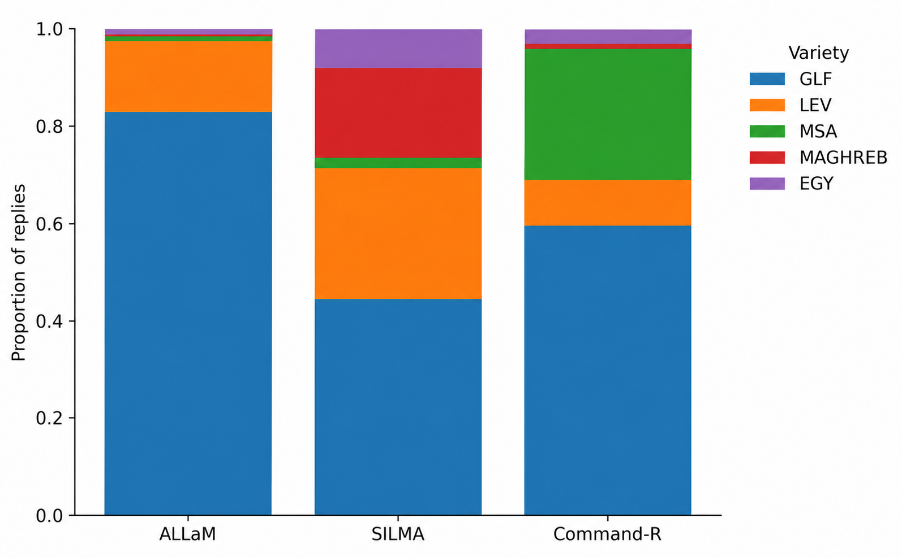

# EMRA Component Evaluation Setup and Results (Supplementary Material)

This file is the supplementary material for the paper *EMRA: A Bilingual, Emotion-Aware Embodied Robot for Autistic Children, with a Feasibility Pilot*. It gives the full component evaluation setup (Part A) and the full component-level results (Part B), which are summarized in Table 2 of the paper. Per-candidate numbers are in [model_selection_results.md](model_selection_results.md), and checkpoints and training settings are in [model_and_training_details.md](model_and_training_details.md).

# Part A. Component Evaluation Setup

The candidates, evaluation data, and metrics used to select each
component are described below.

### Text-Based Emotion Detection

Emotion detection in EMRA has two approaches, text-based and
vision-based. The robot gives priority to the child’s spoken words,
because facial expression is a less reliable signal of emotion for
autistic children (Trevisan, Hoskyn, and Birmingham 2018; Grossard et
al. 2020).

#### Dataset construction.

This study contributed two datasets, English and Arabic, because no
existing resource matches the domain. English emotion corpora are
adult-authored, the largest being GoEmotions with 58,009 Reddit
comments (Demszky et al. 2020). Resources involving children are
speech-based, such as IESC-Child (Pérez-Espinosa et al. 2020) and
CALMED (Sousa et al. 2023), which support recognition from signal
features rather than the fine-tuning of a text classifier and have no
Arabic equivalent. Arabic resources follow the same adult-based pattern,
drawn from social media (Al-Khatib and El-Beltagy 2017; Alqahtani and
Alothaim 2022) or broadcast speech (Kahhoul et al. 2026). None reflects
communication patterns associated with autism, such as repeated speech
or the expression of distress through bodily sensations, or covers the
Gulf dialect spoken by children in the target centers.

Each dataset contains 1,000 written scenarios reflecting the speech of
children aged 6 to 8, labeled with one of five emotions: Happy, Sad,
Neutral, Angry, and Fear. The vocabulary is age-appropriate, abstract
emotional terms were excluded, and the label never appears in the
scenario, so the classifier must read the sentence rather than match
keywords. Scenarios are grouped as general, covering school, home, play,
meals, and bedtime; ASD-coded, covering sensory responses, strong
interests, literal understanding, distress at routine changes, repeated
speech, and emotion described through bodily sensations; and ambiguous,
where the emotion is unclear without the surrounding situation. The
English set extends the 200 scenarios from our earlier work on
TEMO (Alali and Ezzini 2026), and the remaining scenarios in both
languages were produced with a large language model under explicit
writing rules, then reviewed and filtered by the first author. The
composition of both datasets is given in the [model selection
results](https://github.com/fatimah48/EMRA_Educational-Robot-/blob/main/model_selection_results.md)
of the EMRA repository.

#### Annotation.

Each dataset was annotated independently by two raters, with the Arabic
set rated by two Arabic speakers who saw the scenario text alone.
Agreement was 80.9% in English and 86.6% in Arabic. It was lowest for
the ambiguous and ASD-coded groups, which matches their greater
difficulty when interpreted from wording alone. Disagreement
concentrated on Angry, where one rater read frustration and the other
read hurt.

#### Models and protocol.

The candidates for this component, and for every other component, are
listed in the main paper (Table 2). The Arabic encoders were chosen for
their familiarity with dialectal Arabic rather than Modern Standard
Arabic alone. The English models already carry an emotion-classification
layer, so they were evaluated both off-the-shelf and after fine-tuning,
while the Arabic models received a new five-class layer and were
evaluated after fine-tuning only. All six were fine-tuned under the same
protocol and evaluated on the same 250 held-out scenarios, with
macro-averaged F1 as the selection metric because it weights all five
classes equally. The label mappings, the fine-tuning settings, and the
full metric definitions are given in the [model and training
details](https://github.com/fatimah48/EMRA_Educational-Robot-/blob/main/model_and_training_details.md)
of the EMRA repository.

### Vision-Based Emotion Detection

The English and Arabic systems share vision-based emotion detection
because it depends on the camera-captured face rather than language.
Three models from different architectural families were compared:
HSEmotion, which learns from the whole face (Savchenko 2022), POSTER++,
which combines features from small facial regions with landmark
information through cross-attention (Mao et al. 2025), and the
attention-based DDAMFN++ (Zhang et al. 2023). All three output the same
eight categories, which were mapped to the five target emotions, with
Surprise folded into Neutral and Disgust and Contempt into Angry.

The candidates were evaluated on a balanced 500-image subset of the
FER2013 test split (Goodfellow et al. 2015), 100 images per target
class. The models were trained on AffectNet (Mollahosseini, Hasani, and
Mahoor 2019), so testing on FER2013 measures whether they generalize to
images unlike those seen during training. Ranking combined
macro-averaged F1 at 60% with inference speed at 40%, both min-max
normalized. Latency was included because visual emotion recognition runs
repeatedly during interaction, and slow inference would reduce how often
the robot could update the detected emotion.

### Large Language Models

Six offline models were evaluated, three per language, all run locally
through Ollama (Ollama n.d.) with four-bit quantization. Within each
language the candidates received the same system prompt, child speech,
and emotion label, with a fixed seed. Dataset labels were used instead
of classifier predictions, so emotion-classification errors did not
affect the judgment of response quality. The Arabic prompt asked for
natural Saudi colloquial Arabic rather than Modern Standard Arabic,
which matters because the model card for C4AI Command R7B Arabic names
MSA as its primary variety (Cohere Labs 2025). Each language used 200
scenarios from its emotion dataset, 40 per class, giving 600 responses
per language.

Responses were scored from 1 to 5 on empathy, language appropriateness,
support, engagement, and safety, using a rubric published with the
[rating
scales](https://github.com/fatimah48/EMRA_Educational-Robot-/blob/main/rating_scales.md).
Two human evaluators rated every response independently, and the Arabic
responses were rated by two Saudi speakers, since dialect naturalness is
the one dimension no automatic measure settles reliably. The human
scores are the main result. Three LLM judges per language scored the
same responses to validate them, none sharing a model family with a
candidate (Panickssery, Bowman, and Feng 2024), because judges may show
biases that do not match human ratings (Bavaresco et al. 2025; Wang et
al. 2024).

The Arabic evaluation adds automatic measures over all 600 responses,
since the rubric does not directly test whether the language is Saudi
colloquial. A lexicon proxy reports a dialectness ratio and an MSA-drift
flag, and a learned identifier based on MARBERTv2 (Amin 2025) assigns
each reply to Gulf, Levantine, Egyptian, Maghrebi, or MSA. Readability
was measured with the BAREC 19-level model (Elmadani, Habash, and
Taha-Thomure 2025; CAMeL Lab 2025) to compare candidates rather than to
give age levels. Pairwise differences in overall score were tested with
the Wilcoxon signed-rank test at $p < 0.05$, with Holm adjustment for
Arabic, and rater agreement was measured with within-one agreement and
quadratic-weighted Cohen’s kappa. The full statistical procedure is
given in the [model selection
results](https://github.com/fatimah48/EMRA_Educational-Robot-/blob/main/model_selection_results.md)
of the EMRA repository.

### Automatic Speech Recognition

Six open-weight models were compared, three per language. Each language
used 200 scenarios from its text-emotion dataset, recorded by an adult
in a quiet room, with the original scenario text as the reference
transcript. The Arabic scenarios were written in Saudi colloquial Arabic
rather than Modern Standard Arabic, since dialectal vocabulary and
pronunciation affect recognition.

Candidates were ranked on recognition at 65% and efficiency at 35%,
because transcription errors propagate to the emotion classifier and the
language model. Both the reference and the transcription were normalized
before word and character error rates were computed, with raw values
retained for comparison. Normalization removes differences the written
scenarios never contained, such as punctuation in English and
diacritics, tatweel, and letter variants in Arabic, so the normalized
values are the main recognition measures. The metrics, their weights,
and the full normalization rules are given in the [model selection
results](https://github.com/fatimah48/EMRA_Educational-Robot-/blob/main/model_selection_results.md)
of the EMRA repository.

### Text-to-Speech

Each English model used one fixed voice for all 200 texts. Arabic models
used the same calm-voice reference clip for all three. Each language
used 200 responses from its dataset, 40 per emotion class, cleaned
before synthesis by removing emojis, action text inside parentheses, and
repeated whitespace. For Arabic, tashkeel was added automatically using
CAMeL Tools (Obeid et al. 2020), because Arabic-F5-TTS-v2 requires it.

Candidates were ranked on a weighted score that puts perceptual quality
first in English and intelligibility first in Arabic, since the
naturalness model was trained mainly on non-Arabic speech. Word and
character error rates were measured by transcribing the generated audio,
so they reflect the synthesizer and the recognizer together rather than
pronunciation alone. A native Saudi listener also rated a blinded
stratified sample of 30 outputs per Arabic model, six per emotion class,
using the five-point naturalness scale published with the [rating
scales](https://github.com/fatimah48/EMRA_Educational-Robot-/blob/main/rating_scales.md).
With one listener, this confirmed the direction of the automatic ranking
without contributing to the weighted score.

### Vision-Language Models

The VLM is used when visual information is required during interaction,
in both English and Arabic. Three open-weight models were compared, all
run locally with four-bit quantization.

#### Selection benchmarks.

Each candidate was tested on object hallucination, scene understanding,
and deployment cost. All three received the same items and were
instructed to answer only yes or no, with the sampling seed fixed at 42.
The MME and POPE subsets are samples of 300 items rather than the full
benchmarks. Metrics were combined through min-max normalization with
latency and memory inverted, assigning 0.55 to answer quality and 0.45
to deployment cost, which reflects the latency and memory constraints of
the complete EMRA pipeline. The metrics and their weights are given in
the [model selection
results](https://github.com/fatimah48/EMRA_Educational-Robot-/blob/main/model_selection_results.md)
of the EMRA repository.

#### Image description validation.

POPE and MME ask only yes/no questions, so they do not test the short
description the VLM passes to the LLM as visual context in deployment.
The selected model was therefore validated on full descriptions in both
languages. Fifty images were sampled from POPE, the same 50 for English
and Arabic, with one description per image. Each description was rated
by one human for factual accuracy against the image, on the 1 to 5 scale
published with the [rating
scales](https://github.com/fatimah48/EMRA_Educational-Robot-/blob/main/rating_scales.md),
and by one automatic judge for language quality alone, covering clarity,
grammar, repetition, and coherence. Visual grounding therefore stayed
under human judgment. Llama-3.1-8B-Instruct judged English fluency and
ALLaM-7B judged Arabic, so that fluency was assessed in the language
being generated, with all other settings identical across the two
languages.

# Part B. Component-Level Results

This section reports the evaluation of each system component, covering
emotion detection, speech recognition, speech synthesis, response
generation, and visual grounding, for both the English and the Arabic
pipelines. Each component was selected by comparing three open-weight
candidates in the same language setting, listed in the main paper (Table
2).

the main paper (Table 2) gives the selected model and its headline
result, and the full comparison for every candidate is available in the
[model selection
results](https://github.com/fatimah48/EMRA_Educational-Robot-/blob/main/model_selection_results.md)
of the EMRA repository.

Fine-tuning raised English macro-F1 from 68.1% to 86.0% for
RoBERTa-large and from 54.5% to 76.5% for DistilRoBERTa, leaving the
ranking unchanged. The Arabic models were closer together, with
MARBERTv2 at 84.3% ahead of AraBERTv02-Twitter at 79.8% and CAMeLBERT-DA
at 77.8%. Errors were concentrated among the negative emotions in both
languages, and Sad was the weakest Arabic class at 73.7% F1. These
scores come from held-out scenario test sets rather than children’s live
speech, and the two datasets differ in composition and length, so they
are not a ranking between languages. For facial emotion, POSTER++ took
the highest accuracy and macro-F1 while costing only 0.61 ms more than
the fastest candidate. Its scores are moderate, 76.8% F1 on Happy and
37.2% on Fear, because the models were tested on FER2013 using
checkpoints trained on AffectNet.

Mistral-7B-Instruct-v0.3 led every quality criterion in English and was
ranked first by the human raters and the automated panel, scoring
significantly higher than both alternatives. Arabic was less settled.
ALLaM-7B led the human evaluation at 3.65, ahead of Command R7B Arabic
at 3.31 and SILMA-9B at 2.07, while the automated judge placed Command-R
first, so the two evaluations agreed only on the weakest model.
Agreement was weakest on Arabic language appropriateness, where the
correlation was 0.02, and the judges scored 2.25 points higher. The
results for SILMA show this issue clearly, rated 4.80 by the judges and
1.44 by the native raters. The human evaluation was therefore the basis
for the Arabic choice. ALLaM also produced the highest proportion of
Gulf dialect at 83.0%, against 59.5% for Command-R, which drifted toward
Modern Standard Arabic in 38.5% of its replies, as the figure below
shows. Safety behaved differently from quality, with pass rates of 99.5%
for Command-R, 97.5% for ALLaM, and 91.5% for SILMA, so the quality
winner was not the safest model.

*Figure: Predicted dialect of each model's Arabic replies, classified using MARBERTv2.*

For speech, Whisper Large-v3 produced the lowest normalized error rate
in English at 8.90% WER and FastConformer in Arabic at 27.9%, and both
used the least GPU memory in their pipeline while every candidate ran
faster than real time. Normalization changes the Arabic ranking, since
it removes penalties from diacritics, tatweel, and letter variants
rather than indicating more accurate recognition, and the higher Arabic
rates partly reflect the Saudi colloquial speech in the recordings. On
the synthesis side, Kokoro took the best value on every scored English
measure and generated each response in 148.6 ms. The Arabic models
performed similarly overall, with NAMAA rated 0.6 points higher by the
blinded listener while SILMA produced lower error rates, ran about four
times faster, and used less than one-tenth of the GPU memory, so SILMA
was selected on that balance.

Qwen3-VL-4B was selected for visual grounding. It achieved the best MME
accuracy and made only 4 false object claims, against 11 for
LLaVA-OneVision-7B and 29 for SmolVLM2-2.2B, without the twelvefold
latency of LLaVA-OneVision-7B. Bilingual description validation over 50
images follows in the table below, where English scored 0.14 higher on
rated accuracy, with 48 of 50 English descriptions rated 4 or 5. Each
measure used one rater, so the results confirm performance in both
languages rather than rank them.

| Evaluation           |   English    |  Arabic  |
|:---------------------|:------------:|:--------:|
| Number of images     |      50      |    50    |
| Human accuracy (1-5) |     4.64     |   4.50   |
| Fluency judge        | Llama-3.1-8B | ALLaM-7B |
| Fluency score (1-5)  |     3.98     |   3.94   |

# References

Alali, Fatimah, and Saad Ezzini. 2026. “TEMO: An LLM-Powered Interactive
Social Robot for Supporting Children with Autism Spectrum Disorder.”

Al-Khatib, Amr, and Samhaa R. El-Beltagy. 2017. “Emotional Tone
Detection in Arabic Tweets.” In *Computational Linguistics and
Intelligent Text Processing (CICLing 2017)*. Springer.
<https://doi.org/10.1007/978-3-319-77116-8_8>.

Alqahtani, Ghadah, and Abdulrahman Alothaim. 2022. “Emotion Analysis of
Arabic Tweets: Language Models and Available Resources.” *Frontiers in
Artificial Intelligence* 5. <https://doi.org/10.3389/frai.2022.843038>.

Amin, Ibrahim. 2025. “MARBERTv2 Arabic Written Dialect Classifier.”
Model card, Hugging Face; Hugging Face.
<https://huggingface.co/IbrahimAmin/marbertv2-arabic-written-dialect-classifier>.

Bavaresco, Anna, Raffaella Bernardi, Leonardo Bertolazzi, Desmond
Elliott, Raquel Fernández, Albert Gatt, Esam Ghaleb, et al. 2025. “LLMs
Instead of Human Judges? A Large Scale Empirical Study Across 20 NLP
Evaluation Tasks.” In *Proceedings of the 63rd Annual Meeting of the
Association for Computational Linguistics (Volume 2: Short Papers)*,
238–55. Association for Computational Linguistics.
<https://doi.org/10.18653/v1/2025.acl-short.20>.

CAMeL Lab. 2025. “AraBERTv02+Word+CE Readability Model.” Model card,
Hugging Face.
<https://huggingface.co/CAMeL-Lab/readability-arabertv02-word-CE>.

Cohere Labs. 2025. “C4AI Command R7B Arabic.” Model card, Hugging Face.
<https://huggingface.co/CohereLabs/c4ai-command-r7b-arabic-02-2025>.

Demszky, Dorottya, Dana Movshovitz-Attias, Jeongwoo Ko, Alan Cowen,
Gaurav Nemade, and Sujith Ravi. 2020. “GoEmotions: A Dataset of
Fine-Grained Emotions.” In *Proceedings of the 58th Annual Meeting of
the Association for Computational Linguistics*, 4040–54.
<https://doi.org/10.18653/v1/2020.acl-main.372>.

Elmadani, Khalid N., Nizar Habash, and Hanada Taha-Thomure. 2025. “A
Large and Balanced Corpus for Fine-Grained Arabic Readability
Assessment.” In *Findings of the Association for Computational
Linguistics: ACL 2025*, 16376–400. Vienna, Austria: Association for
Computational Linguistics.
<https://doi.org/10.18653/v1/2025.findings-acl.842>.

Goodfellow, Ian J., Dumitru Erhan, Pierre Luc Carrier, Aaron Courville,
Mehdi Mirza, Ben Hamner, Will Cukierski, et al. 2015. “Challenges in
Representation Learning: A Report on Three Machine Learning Contests.”
*Neural Networks* 64: 59–63.
<https://doi.org/10.1016/j.neunet.2014.09.005>.

Grossard, Charline, Arnaud Dapogny, David Cohen, Sacha Bernheim, Estelle
Juillet, Fanny Hamel, Stéphanie Hun, et al. 2020. “Children with Autism
Spectrum Disorder Produce More Ambiguous and Less Socially Meaningful
Facial Expressions: An Experimental Study Using Random Forest
Classifiers.” *Molecular Autism* 11: 5.
<https://doi.org/10.1186/s13229-020-0312-2>.

Kahhoul, Zineddine Sarhani, Nadjiba Terki, Habiba Dahmani, Belkacem
Athamena, Zina Houhamdi, Madina Hamiane, and Mohammed Bourennane. 2026.
“Automatic Speech Emotion Recognition for Arabic Dialects: A New Dataset
and Machine Learning Framework.” *Cluster Computing* 29 (26).
<https://doi.org/10.1007/s10586-025-05830-y>.

Mao, Jiawei, Rui Xu, Xuesong Yin, Yuanqi Chang, Binling Nie, Aibin
Huang, and Yigang Wang. 2025. “POSTER++: A Simpler and Stronger Facial
Expression Recognition Network.” *Pattern Recognition* 157: 110951.
<https://doi.org/10.1016/j.patcog.2024.110951>.

Mollahosseini, Ali, Behzad Hasani, and Mohammad H. Mahoor. 2019.
“AffectNet: A Database for Facial Expression, Valence, and Arousal
Computing in the Wild.” *IEEE Transactions on Affective Computing* 10
(1): 18–31. <https://doi.org/10.1109/TAFFC.2017.2740923>.

Obeid, Ossama, Nasser Zalmout, Salam Khalifa, Dima Taji, Mai Oudah,
Bashar Alhafni, Go Inoue, Fadhl Eryani, Alexander Erdmann, and Nizar
Habash. 2020. “CAMeL Tools: An Open Source Python Toolkit for Arabic
Natural Language Processing.” In *Proceedings of the Twelfth Language
Resources and Evaluation Conference*, 7022–32. Marseille, France:
European Language Resources Association.

Ollama. n.d. “Ollama: Run Large Language Models Locally.” Software.
Accessed August 4, 2026. <https://ollama.com>.

Panickssery, Arjun, Samuel R. Bowman, and Shi Feng. 2024. “LLM
Evaluators Recognize and Favor Their Own Generations.” In *Advances in
Neural Information Processing Systems*. Vol. 37.
<https://proceedings.neurips.cc/paper_files/paper/2024/hash/7f1f0218e45f5414c79c0679633e47bc-Abstract-Conference.html>.

Pérez-Espinosa, Humberto, Juan Martínez-Miranda, Ismael Espinosa-Curiel,
Josefina Rodríguez-Jacobo, Luis Villaseñor-Pineda, and Himer
Avila-George. 2020. “IESC-Child: An Interactive Emotional Children’s
Speech Corpus.” *Computer Speech and Language* 59: 55–74.
<https://doi.org/10.1016/j.csl.2019.06.006>.

Savchenko, Andrey V. 2022. “HSEmotion: High-Speed Emotion Recognition
Library.” *Software Impacts* 14: 100433.
<https://doi.org/10.1016/j.simpa.2022.100433>.

Sousa, Annanda, Karen Young, Mathieu d’Aquin, Manel Zarrouk, and
Jennifer Holloway. 2023. “Introducing CALMED: Multimodal Annotated
Dataset for Emotion Detection in Children with Autism.” In *Universal
Access in Human-Computer Interaction (HCII 2023)*. Springer.
<https://doi.org/10.1007/978-3-031-35681-0_43>.

Trevisan, Dominic A., Maureen Hoskyn, and Elina Birmingham. 2018.
“Facial Expression Production in Autism: A Meta-Analysis.” *Autism
Research* 11 (12): 1586–1601. <https://doi.org/10.1002/aur.2037>.

Wang, Peiyi, Lei Li, Liang Chen, Zefan Cai, Dawei Zhu, Binghuai Lin,
Yunbo Cao, et al. 2024. “Large Language Models Are Not Fair Evaluators.”
In *Proceedings of the 62nd Annual Meeting of the Association for
Computational Linguistics (Volume 1: Long Papers)*, 9440–50. Association
for Computational Linguistics.
<https://doi.org/10.18653/v1/2024.acl-long.511>.

Zhang, Saining, Yuhang Zhang, Ye Zhang, Yufei Wang, and Zhigang Song.
2023. “A Dual-Direction Attention Mixed Feature Network for Facial
Expression Recognition.” *Electronics* 12 (17): 3595.
<https://doi.org/10.3390/electronics12173595>.

